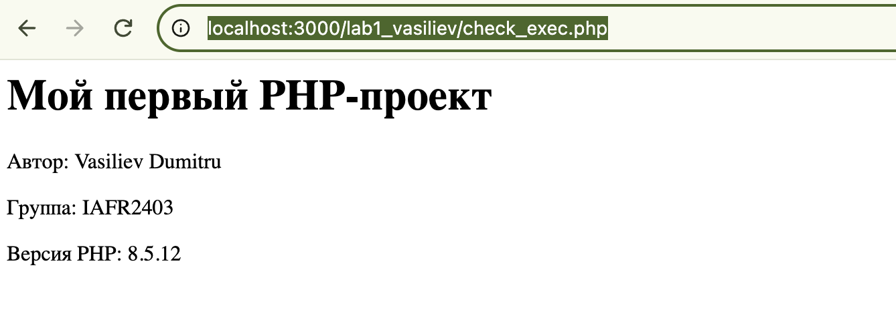
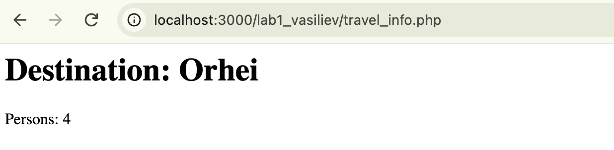
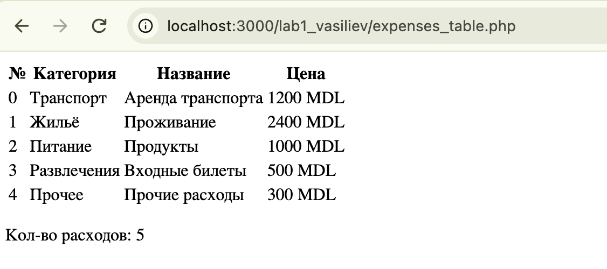
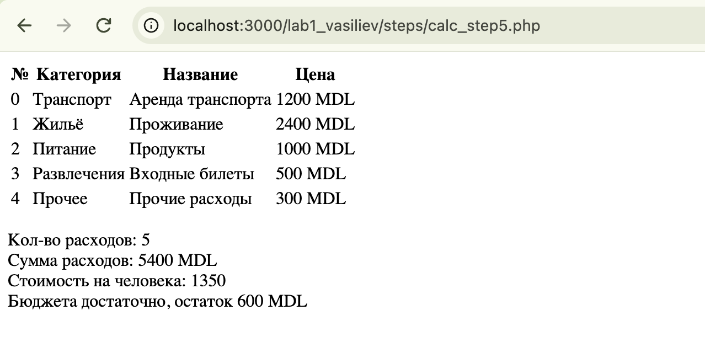
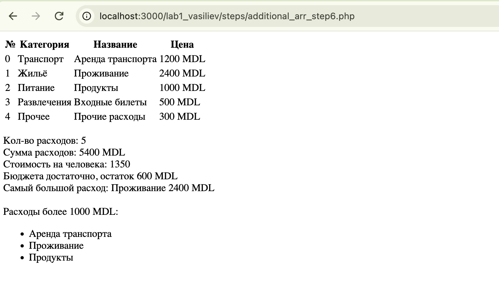
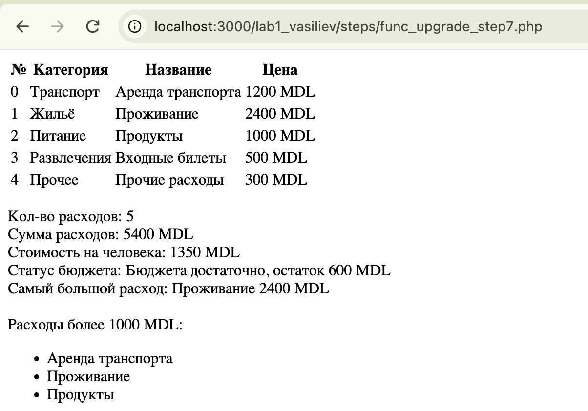
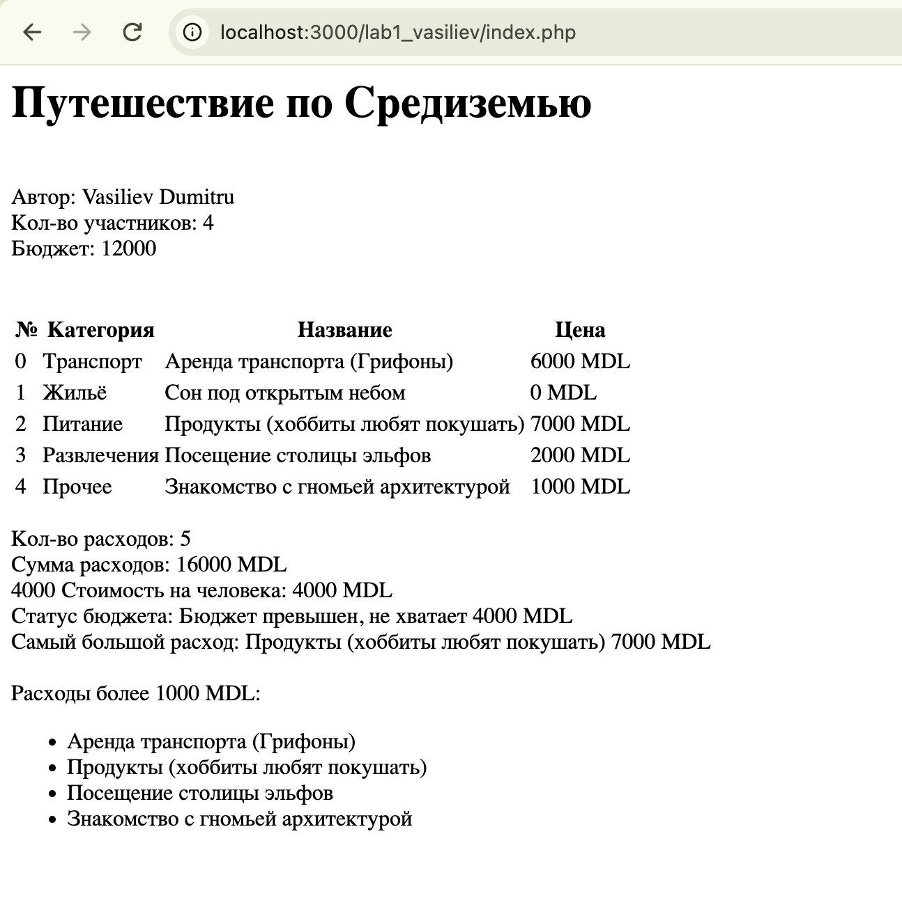

# Лабораторная работа №1. Настройка среды разработки и приложение «Бюджет поездки»
## Цель работы

Научиться запускать PHP-проект на локальном сервере, обрабатывать данные с помощью условий и циклов, создавать массивы и функции, разделять программу на файлы.

## Задание

Разработать страницу, которая показывает расходы на поездку и рассчитывает:

- общую стоимость;
- сумму на одного участника;
- остаток бюджета или сумму превышения;
- самый большой расход.

Данные задаются непосредственно в коде, формы и база данных не используются.

## Структура проекта

```
lab1_vasiliev/
├── index.php        # подключение файлов, вызовы функций и HTML
├── data.php         # информация о поездке, константа VALYUTA и массив расходов
├── functions.php    # функции obshchayaSumma, summaNaCheloveka, statusByudzheta
├── steps/           # промежуточные версии по шагам задания
│   ├── check_exec_step1.php
│   ├── travel_info_step2.php
│   ├── expenses_example_step3.php
│   ├── expenses_table_step4.php
│   ├── calc_step5.php
│   ├── additional_arr_step6.php
│   └── func_upgrade_step7.php
└── lab_img/         # скриншоты результатов
```

## Запуск

Проект открывается через локальный веб-сервер по адресу:

```
http://localhost:3000/lab1_vasiliev/index.php
```

Промежуточные шаги лежат в папке `steps/` и открываются по адресу `http://localhost:3000/lab1_vasiliev/steps/<имя_файла>.php`.

## Ход работы

### 1. Установка и проверка среды

Файл: [`steps/check_exec_step1.php`](steps/check_exec_step1.php)

Создана папка проекта и файл с проверкой выполнения PHP: выводится заголовок, автор, группа и версия PHP через константу `PHP_VERSION`.

```php
echo "<h1>Мой первый PHP-проект</h1>";
echo "<p>Автор: Vasiliev Dumitru</p>";
echo "<p>Группа: IAFR2403</p>";
echo "<p>Версия PHP: " . PHP_VERSION . "</p>";
```

Ссылка: http://localhost:3000/lab1_vasiliev/steps/check_exec_step1.php



### 2. Информация о поездке

Файл: [`steps/travel_info_step2.php`](steps/travel_info_step2.php)

Определены переменные для названия поездки, количества участников и бюджета, а также константа валюты. Значения выводятся в HTML-документе с кодировкой UTF-8 через `<?= ?>`.

```php
$dest = "Orhei";
$prs = 4;
$budget = 6000;
```

Ссылка: http://localhost:3000/lab1_vasiliev/steps/travel_info_step2.php



### 3. Массив расходов

Файл: [`steps/expenses_example_step3.php`](steps/expenses_example_step3.php)

Создан многомерный массив `$rashody` из пяти расходов. У каждого расхода есть название (`nazvanie`), категория (`kategoriya`) и сумма (`summa`).

| Расход            | Категория   | Сумма, MDL |
|-------------------|-------------|-----------:|
| Аренда транспорта | Транспорт   | 1200       |
| Проживание        | Жильё       | 2400       |
| Продукты          | Питание     | 1000       |
| Входные билеты    | Развлечения | 500        |
| Прочие расходы    | Прочее      | 300        |

### 4. Вывод расходов

Файл: [`steps/expenses_table_step4.php`](steps/expenses_table_step4.php)

С помощью `foreach` сформирована HTML-таблица с колонками «№ | Категория | Название | Цена». Валюта берётся из константы `VALYUTA`, под таблицей выводится количество расходов через `count()`.

```php
<?php foreach($rashody as $i => $r): ?>
    <tr>
        <td><?= $i ?></td>
        <td><?= $r["kategoriya"] ?></td>
        <td><?= $r["nazvanie"] ?></td>
        <td><?= $r["summa"] . " " . VALYUTA ?></td>
    </tr>
<?php endforeach; ?>
```

Ссылка: http://localhost:3000/lab1_vasiliev/steps/expenses_table_step4.php



### 5. Вычисления и условия

Файл: [`steps/calc_step5.php`](steps/calc_step5.php)

- **Общая стоимость** — накапливается в переменной `$total`, которая инициализируется нулём перед циклом.
- **Стоимость на человека** — `$total / $prs`.
- **Проверка бюджета** — через `if / elseif / else`:

```php
if ($total < $budget) {
    echo "Бюджета достаточно, остаток " . $budget - $total . " " . VALYUTA;
} elseif ($total === $budget) {
    echo "Бюджет использован полностью";
} else {
    echo "Бюджет превышен, не хватает " . $total - $budget . " " . VALYUTA;
}
```

Результат для исходных данных:

```
Кол-во расходов: 5
Сумма расходов: 5400 MDL
Стоимость на человека: 1350
Бюджета достаточно, остаток 600 MDL
```

Ссылка: http://localhost:3000/lab1_vasiliev/steps/calc_step5.php



### 6. Дополнительная обработка массива

Файл: [`steps/additional_arr_step6.php`](steps/additional_arr_step6.php)

1. **Самый большой расход** — в цикле запоминается индекс элемента с максимальной суммой:

    ```php
    $maxPriceItemIndex = 0;
    foreach($rashody as $i => $r) {
        if ($r["summa"] > $rashody[$maxPriceItemIndex]["summa"]) {
            $maxPriceItemIndex = $i;
        }
    }
    ```

    Для исходных данных: `Проживание — 2400 MDL`.

2. **Расходы от 1000 MDL включительно** — отбираются циклом с условием `>= 1000` в отдельный массив. Если подходящих записей нет, выводится «Нет».

Ссылка: http://localhost:3000/lab1_vasiliev/steps/additional_arr_step6.php



### 7. Создание функций

Файл: [`steps/func_upgrade_step7.php`](steps/func_upgrade_step7.php)

Вычисления вынесены в функции, которые возвращают результат через `return`:

| Функция | Назначение |
|---------|------------|
| `obshchayaSumma($arr)` | сумма всех расходов (для пустого массива — 0) |
| `summaNaCheloveka($t, $p)` | стоимость на одного участника |
| `statusByudzheta($b, $t)` | сообщение о состоянии бюджета с остатком или суммой превышения |

Деление выполняется только если количество участников больше нуля:

```php
$total = obshchayaSumma($rashody);
$bpp = $prs > 0 ? summaNaCheloveka($total, $prs) : 0;
```

Ссылка: http://localhost:3000/lab1_vasiliev/steps/func_upgrade_step7.php



### 8. Разделение на файлы

Файлы: [`index.php`](index.php), [`data.php`](data.php), [`functions.php`](functions.php)

| Файл            | Содержание |
|-----------------|------------|
| `data.php`      | информация о поездке, константа `VALYUTA` и массив расходов |
| `functions.php` | определения функций |
| `index.php`     | подключение файлов, вызовы функций и HTML |

```php
require __DIR__ . "/data.php";
require_once __DIR__ . "/functions.php";
```

После проверки исходные данные заменены собственными — «Путешествие по Средиземью»:

| Расход                             | Категория   | Сумма, MDL |
|------------------------------------|-------------|-----------:|
| Аренда транспорта (Грифоны)        | Транспорт   | 6000       |
| Сон под открытым небом             | Жильё       | 0          |
| Продукты (хоббиты любят покушать)  | Питание     | 7000       |
| Посещение столицы эльфов           | Развлечения | 2000       |
| Знакомство с гномьей архитектурой  | Прочее      | 1000       |

Участников: 4, бюджет: 12000 MDL. Результат:

```
Кол-во расходов: 5
Сумма расходов: 16000 MDL
Стоимость на человека: 4000 MDL
Статус бюджета: Бюджет превышен, не хватает 4000 MDL
Самый большой расход: Продукты (хоббиты любят покушать) 7000 MDL
```

Ссылка: http://localhost:3000/lab1_vasiliev/index.php



## Вывод

В ходе работы был запущен PHP-проект на локальном сервере и создано приложение «Бюджет поездки». Были использованы переменные, константы, многомерные массивы, циклы `foreach`, условия `if / elseif / else`, пользовательские функции с `return`, а также разделение кода на несколько файлов через `require` и `require_once`.
